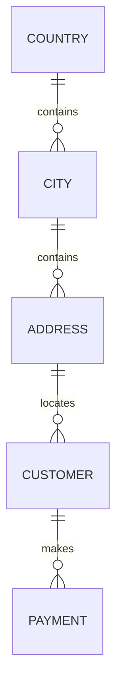

# Rockbuster | SQL Business Analytics

## Business objective

A CareerFoundry Data Analytics case study for a fictional movie rental business considering a move into online streaming. PostgreSQL queries investigate customer spending, geographic market concentration and film catalogue statistics to support business planning.

## Data model

The project uses the [PostgreSQL DVD Rental sample database](https://www.postgresqltutorial.com/postgresql-sample-database/). Customer geography follows `customer.address_id → address.city_id → city.country_id`; payments join through `payment.customer_id`. Film catalogue statistics are analysed separately.

## Featured SQL query

[Revised customer ranking by market](sql/top_customers_by_market.sql)

This portfolio revision ranks countries by customer count, selects the ten highest-volume cities within those countries, aggregates payments by customer and returns the five highest-paying eligible customers alongside their average total payment. It uses geographic IDs instead of names, deterministic tie-breaks and a window aggregate. The query passes executable synthetic SQLite validation; PostgreSQL/DVD Rental execution remains outstanding.

## Original query guide

| Query | Business question |
| --- | --- |
| [Average payment](Average%20amount%20paid%20by%20top%205%20customers) | What is the average total payment of the selected top five customers? |
| [Country distribution](Top%205%20Customers%20by%20Payment%3A%20Country%20Distribution%20Analysis) | How many selected top customers and total customers are in each country? |
| [Top customers by city](Top%205%20High-Paying%20Customers%20from%20the%20Top%2010%20Cities) | Who are the highest-paying customers in the selected markets? |
| [Customer payment benchmark](Top%205%20customers%20with%20highest%20total%20payments) | How does each selected customer's total compare with the group average? |
| [Film statistics](Descriptive%20Statistics%20for%20Film%20Table) | What are the ranges, means and non-null counts for film attributes? |

## Technical skills

PostgreSQL, CTEs, inner and left joins, nested subqueries, grouped aggregations, distinct counts, ranking with ORDER BY and LIMIT, descriptive statistics, and a window aggregate in the revised query.

## Running the queries

1. Install PostgreSQL and restore the DVD Rental sample database using the instructions linked above.
2. Clone this repository and connect to the restored database using pgAdmin, DBeaver or psql.
3. Open `sql/top_customers_by_market.sql` and execute it. Original queries are preserved as extensionless text files and can be opened in a SQL editor.
4. Compare the revised query with the original outputs, checking customer counts, geographic eligibility and payment totals.

## Reproduce the synthetic validation

From the repository root, run `python tests/validate.py` with Python 3.9+ and its standard-library SQLite (3.25+). No downloads or external dependencies are required. The script creates an in-memory relational fixture, executes the featured SQL file, and asserts expected customer IDs, payment totals, group average and empty-payment behaviour. Run without Python's `-O` flag so assertions remain enabled.

[Validation script](tests/validate.py) | [Executed CSV output](results/synthetic_validation.csv)

The synthetic fixture deliberately includes duplicate city names across countries, tied market counts, multiple payments and an excluded high-paying customer. Returned totals are 100, 90, 80, 70 and 60; the average is 80. These are synthetic test values, not DVD Rental business findings. SQLite validation does not establish PostgreSQL compatibility or real-data performance.

## Limitations and next steps

- Synthetic test output is included; no actual DVD Rental result exports are available.
- Original geographic filters use city names, which can conflate distinct cities. The revised query uses IDs and deterministic ordering.
- Validate the revised query against the sample database and test ties, duplicate city names and payment aggregation.
- Consolidate remaining repeated query logic and add reusable SQL scripts and result exports.
- Customer counts and historical payments are descriptive indicators, not forecasts of streaming demand.

The original five coursework queries remain unchanged. The additional query is a portfolio refinement prepared with AI assistance and has passed synthetic SQLite validation and requires PostgreSQL execution and author review.
